# From Zero to Zero Trust

According to the given scenario, the fintech startup is cloud-based, hosting its API on an Ubuntu Server and its database within a PostgreSQL VM on Azure. To harden the system and mitigate the risk of a data breach, a multi-layered defense-in-depth architecture with complementary security solutions should be engineered and deployed. Because it is neither explicitly stated nor implied that the startup maintains any on-premises assets, this strategy will focus strictly on cloud network, system, and application-level security.

## Network Segmentation and Zoning

Hosting both the API server and the database on the same machine represents a poor security practice. If a malicious attacker compromises the application running on the server, they can easily move laterally and gain full access to the database contents.

To prevent such incidents, network segmentation and zoning are highly recommended. Because the API server interacts with the general public, it should be placed within a Demilitarized Zone (Cloud-DMZ). Conversely, the database must be completely restricted from public access and configured to communicate solely with the API server. Therefore, the database should be isolated within a private subnet (Restricted Zone) with no public IP address.

Additionally, using Network Security Groups (NSGs), firewall rules should be configured to allow inbound public traffic to the DMZ only on port 443 (HTTPS). Similarly, a rule must be established on the Restricted Zone that permits inbound traffic exclusively from the DMZ subnet on port 5432 (the default PostgreSQL port) and on port 22 for database server administration by the startup system admin through multihop ssh tunneling.

Below is the network design architecture:
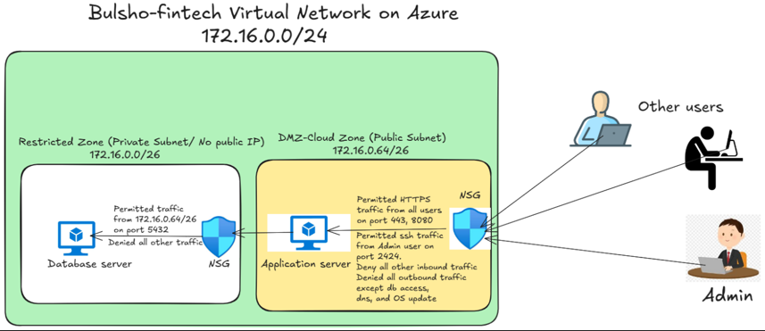

### Creating Virtual Network

To establish an isolated, multi-layered defensive environment, i begin by provisioning a dedicated Virtual Network (VNET) within Microsoft Azure. This network serves as the foundational boundary for the segmented architecture.

A new resource group named <i>rg-bulsho-fintech-prod</i> is created to logically group and manage all production assets for the startup.

This VNET is deployed within Africa, specifically South Africa (My Azure plan showed South Africa as the nearest center) to ensure regional digital compliance and low latency for regional infrastructure, as most service users are in Nairobi and the startup plans to expand to other regions in the continent.
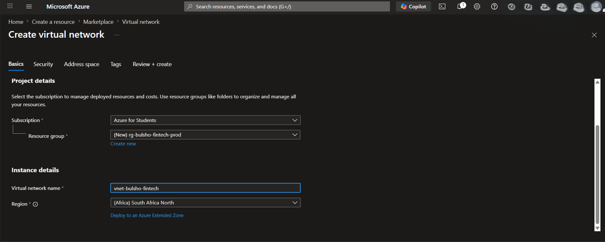
Note: I couldn't provision VMs in South Africa because my subscription only allows Switzerland North, prompting change of VLAN location to Switzerland.

I configured the private ip address and range for the startup VNET. /24 subnet mask was intentionally selected based on the startup's current size and relatively small user base. The scope was limited to 256 addresses to prevent massive unallocated addresses from sitting idle.
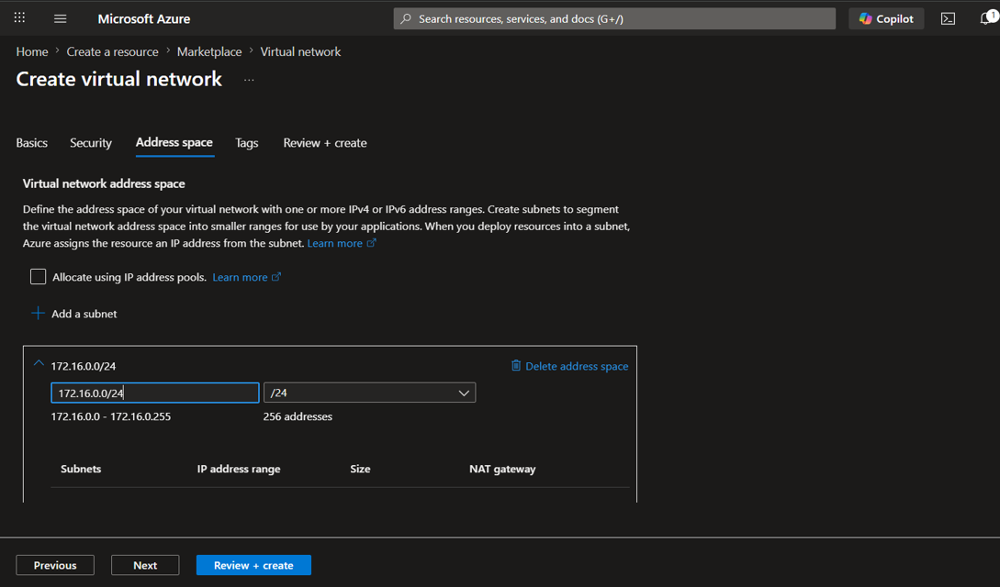

### Restricted Zone (Private Subnet) Configuration

The first subnet created is dedicated strictly to the database layer's isolated subnet, referred as Restricted Zone/Private Subnet in the architecture.The subnet is allocated a /26 subnet mask, establishing an IP address range of 172.16.0.0 - 172.16.0.63, this provides 64 discrete IP addresses, which yields ample address space for database without consuming the entire parent network.
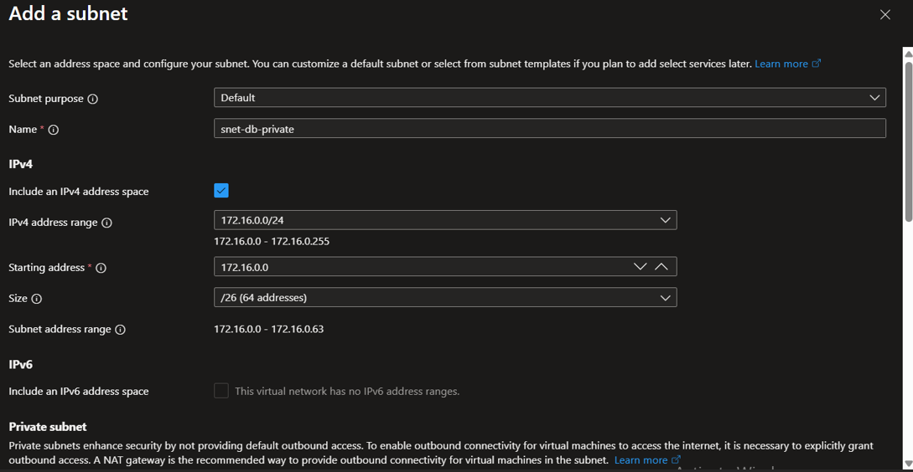

I checked the "Enable private subnet" checkbox to cut off default outbound internet access for any machines in this subnet. It protects the database VM from unauthorized data exfiltration attempts and prevents downloading files directly from the web.

As visually stated in the architecture, machines in this subnet are meant to be entirely isolated. Therefore, to glue this, "NAT gateway" is set to None.

Additionally, i created a new Network Security Group (NSG) named snet-private-nsg to provide stateful firewall mechanism needed to enforce zoning rules. This allows writing of explicit rule that drops all incoming traffic except for legitimate PostgreSQL traffic (on port 5432) and SSH (on port 22) originating specifically from our API server's DMZ subnet.

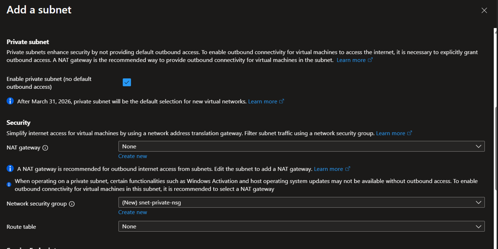

### DMZ-Cloud Zone (Public Subnet) Configuration

This subnet acts as our Cloud-DMZ, housing the public interactive endpoints while keeping them separate from the database infrastructure.
Azure automatically segments the network space linearly. Since our database subnet (snet-db-private) claimed the first block from 172.16.0.0 to 172.16.0.63, this subnet begins precisely at the next available contiguous address, ensuring no overlapping spaces.
The subnet has 64 addresses for ample scaling out of API servers due to anticipated user growth.
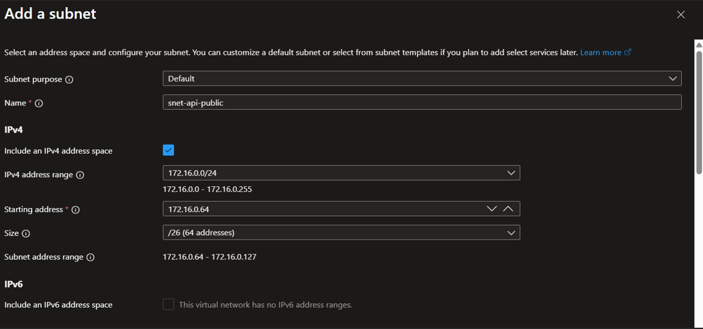

I left "Enable private subnet (no default outbound access)" unchecked to allow the workloads and VMs in this subnet to have internet connectivity. This is crucial for the Ubuntu Server as it needs to perform outbound tasks such as resolving external API dependencies and communicating with external fintech payment gateways. I also enforced a separate NSG for this subnet to ensure complete separation of duties.
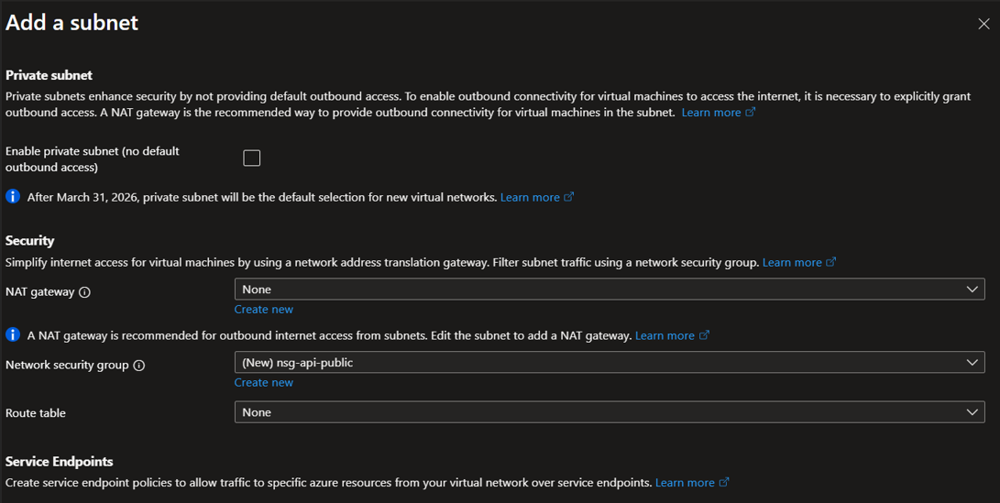

As shown below, the zones are now set.
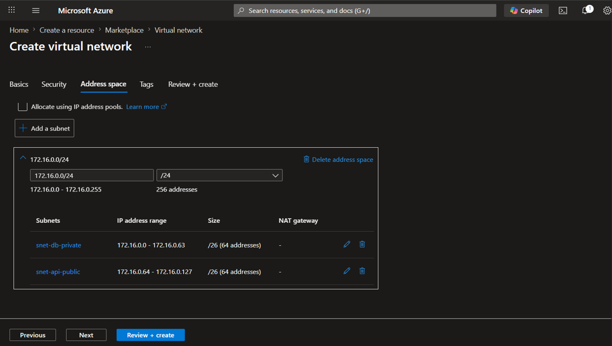

After confirming that there is no conflicting IP space and incorrect configurations, i deployed the VNET.
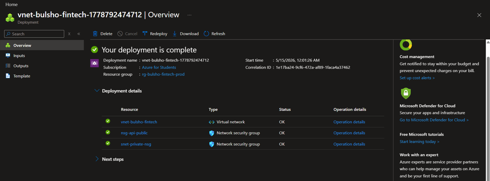

## Virtual Machines Provisioning

The API server and database should sit on servers. These servers are created as Virtual Machines.

### API Server VM Provisioning

I chose to go with Ubuntu Server 22.04 LTS - Gen 2 for the startup's API server because it ensures five years of predictable, enterprise-grade security patches and system stability. Gen 2 machine also offers critical cloud security features that protect the OS against rootkits and boot-level malware.
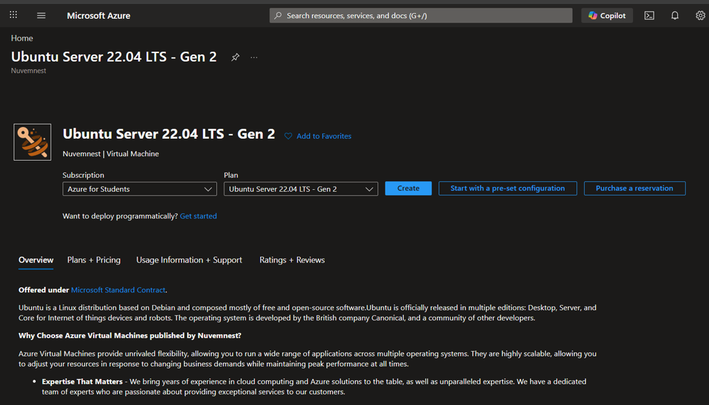
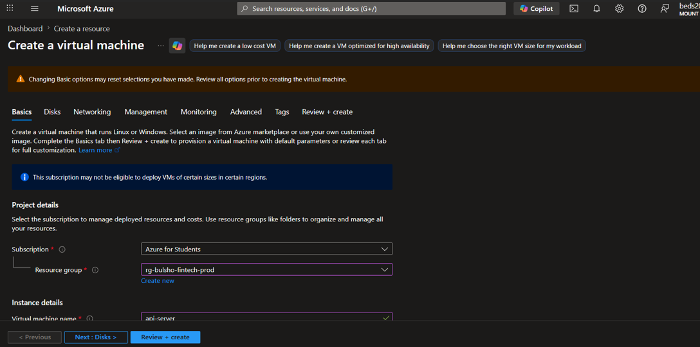
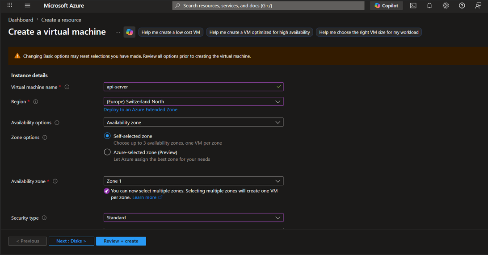

I mapped the api-server directly to our frontline network fabric during the provisioning phase. I selected our vnet-bulsho-fintech virtual network and placed the instance within the public-facing snet-api-public subnet (172.16.0.64/26). To ensure external consumers can seamlessly interact with the application, I enabled a new public IP resource designated as api-server-ip. Additionally, I explicitly set the NIC network security group to None since the subnet is already bound to snet-public-nsg, ensuring a clean design that handles all firewall rules at the DMZ boundary.
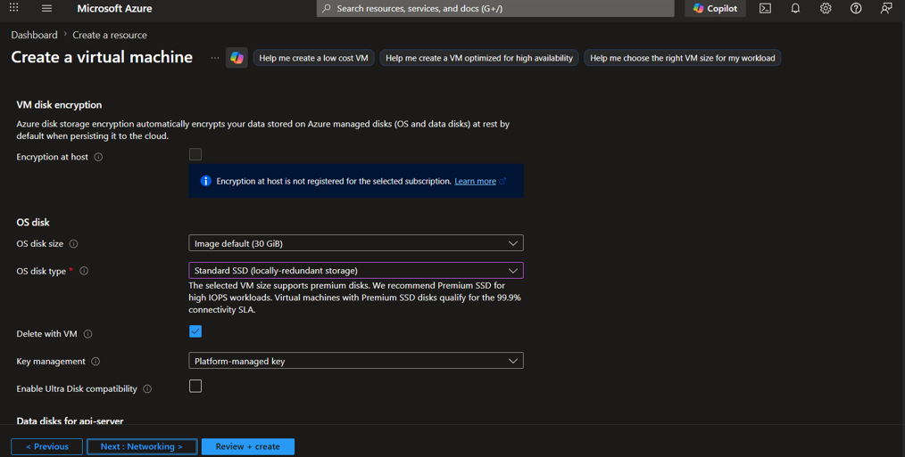
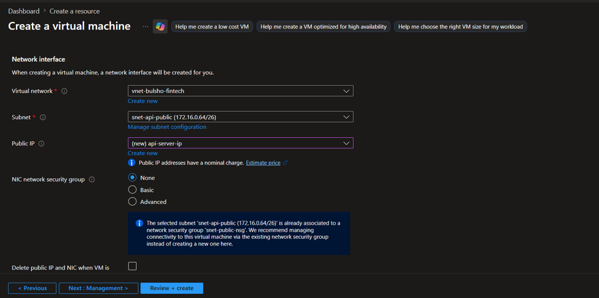

Once the deployment process wrapped up, I verified the live status and operational specifications of the compute resource. The api-server is now successfully running in Switzerland North (Zone 1) under the production resource group, rg-bulsho-fintech-prod. It has been provisioned with a Standard D2s v3 size featuring 2 vCPUs and 8 GiB of memory, and is actively listening on its assigned primary public IP address, giving the fintech API a solid and scalable environment to begin handling traffic.

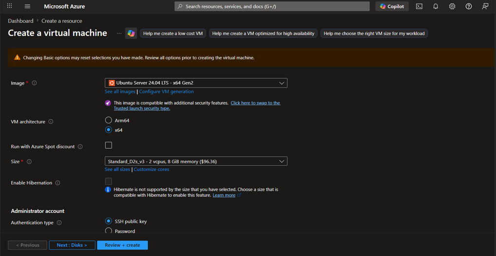
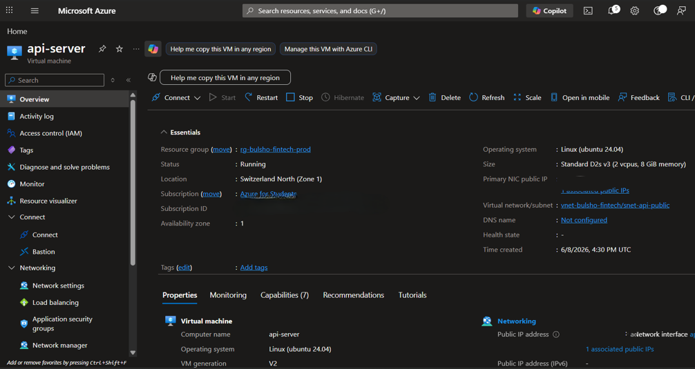

### Database Server VM Provisioning

Bulsho fintech’s app is powered by PostgreSQL database. Bulsho fintech’s priority is achieving granular control over the environment and remaining highly cost-sensitive. With this in mind, the most appropriate choice is to provision Ubuntu VM and install database services (in later phase).

I provisioned a similar virtual machine as the API server and placed it in the private subnet.
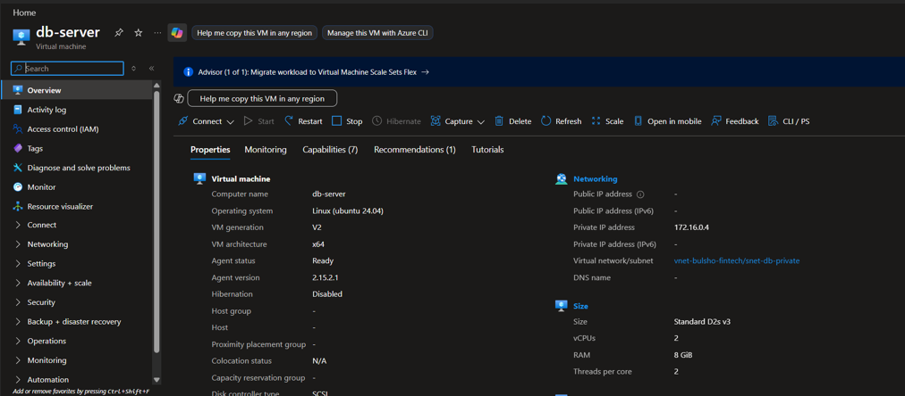

## Network Hardening

Now, it is time to harden each subnet by creating rules on the Network Security Groups (NSGs) to explicitly define which categories of packets to allow and which to deny.

### Hardening the Public Subnet (Cloud-DMZ)

This is where the API server sits. The host runs our public-facing APIs along with a pgAdmin web interface for database interaction and management. Additionally, to facilitate secure file transfers and remote management, SSH is enabled. With this in mind, I created three inbound security rules on the public subnet NSG:

- Allow SSH traffic from the administrator's specific IP address to the API server on port 22.
- Allow inbound HTTPS packets on port 443 from any source IP address to accommodate general public user traffic.
- Allow HTTP packets from the administrator's IP address to port 80 for restricted web-based management access.
  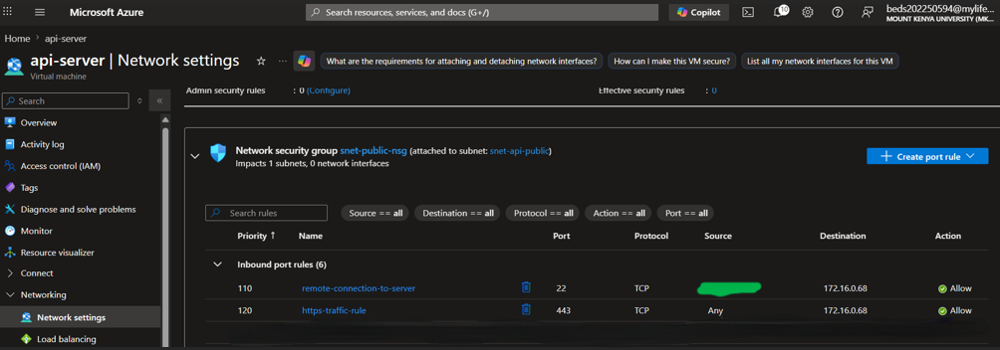

#### Testing the NSG rules and connections

- Rule 110: Connecting the server from admin’s computer using SSH

To verify that my Network Security Group rules are functioning correctly, I initiated an SSH connection from my local management machine. By executing the command <i>ssh -i ./Downloads/api-server_key.pem <username>@<PUBLIC_IP></i>, I authenticated securely using the pre-configured private key file rather than a password.
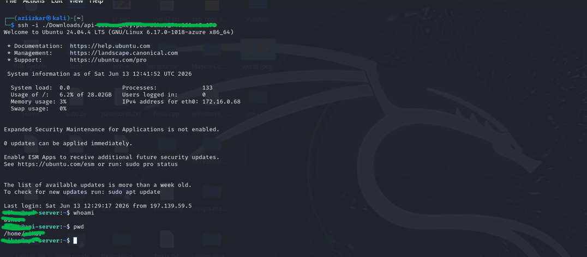

As shown above, the connection succeeded perfectly. The Ubuntu banner confirms a successful login to the api-server host. Running the commands whoami and pwd further validates that I have secure shell access.

To confirm, that only ssh connections initiated from local management machine (admin machine) goes through the file, i tried to initiate from a different machine (just changed the IP by connecting to VPN) using the correct authentication keys. The connection failed with "connection reset by peer by server" message.
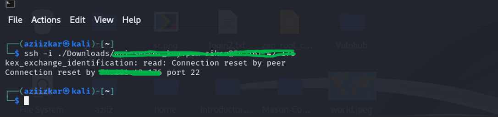

- Rule 120: HTTPS traffic on port 443

This was accessible from any device with internet connection as the NSG allows traffic indiscriminate of IP address. Traffic aimed at port 80 is allowed but redirected by Nginx ( to be configured in later phase) that sits on the edge of the server.
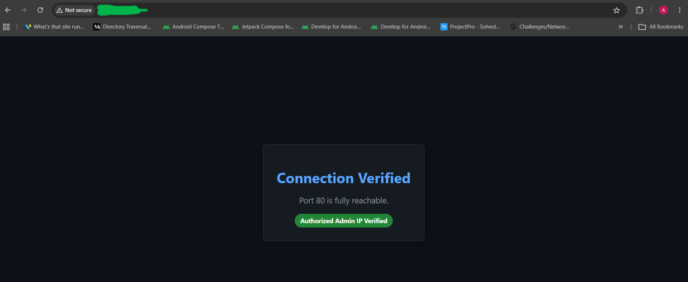
<!-- 
- Rule 130: HTTP connection from admin’s machine (local management machine) to api server.

<!-- I tested the HTTP access rule by navigating by seeting up simple web page on the server and navigating to the server's public IP address from my local management browser. The connection went through successfully because the NSG is configured to allow traffic on port 80 from the admin machine. I will use this for pg4admin to manage database graphically.  

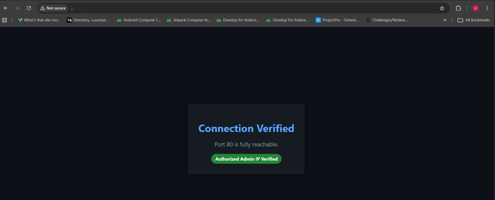 

The server log shows / route access by local management machine
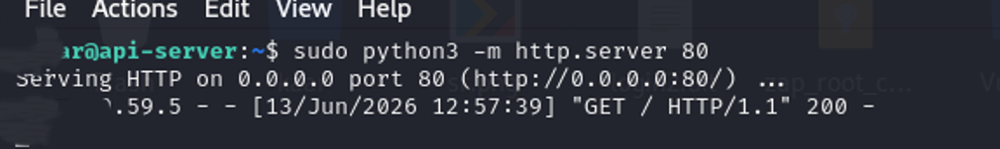

I checked if port 80 is accessible from another machine, the site was unreachable.
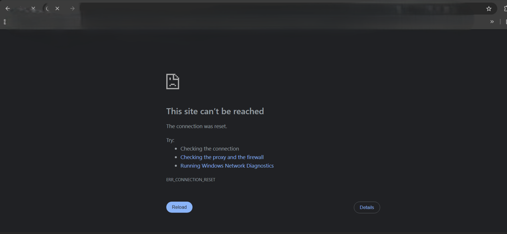

The unauthorized IP request was successfully blocked by Network Security Group (NSG), hence failed to hit the api server. -->

### Hardening the Private Subnet (Restricted Zone)

This subnet is created to remain hidden and inaccessible from the public. The subnet houses the database server, which is a critical asset for Bulsho Fintech. The database can only be communicated with by the API server by virtue of retrieving information from and writing to the database. Albeit, it is deemed necessary for remote administration of this database. To manage the database, I decided to use the API server as a multi-hop tunnel. I could’ve used Azure Bastion, but to be mindful of Bulsho Fintech’s cost sensitivity, I opted to use the API server as the linkage between the admin’s machine and the database server. That said, the private subnet permits the following categories of packets from the API server’s private IP:

- Communication on port 22 for SSH and remote server management.

- Communication on port 5432 for database interaction by pgAdmin.
  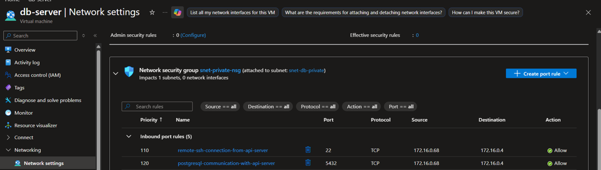

#### Testing the NSG rules

- Rule 110: remote-ssh-connection-from-api-server

The API server successfully connected with the Database server through SSH.
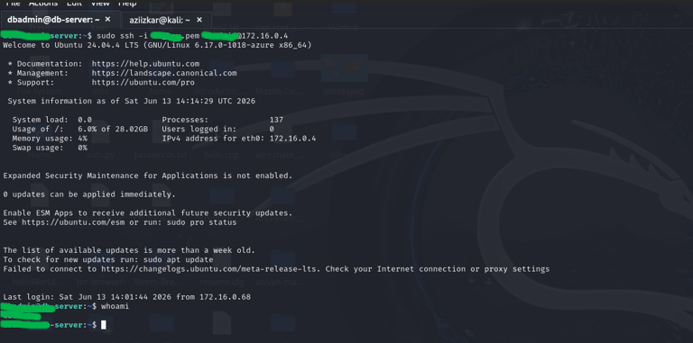

I also tried to initiate ssh connection from my local machine, but it failed because the rule only accepts ssh requests from api server internal IP address.
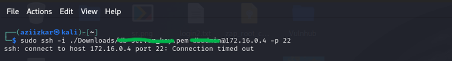

The question is how would it be possible to manage database server if Administrators can't access from their local machine?

The administration can be done by using the local management machine as a proxy to perform Multi-hop SSH connection.

Isn't it unsecure to have the database server SSH authentication key in the api server?

Yes, it is unsecure. To mitigate this, a concept called SSH Agent Forwarding is employed.
Instead of copying sensitive private keys to intermediate cloud storage, SSH Agent Forwarding allows the local machine to act as a secure identity proxy. When initialized, a background process called ssh-agent runs locally in the management machine system memory, safely holding private cryptographic keys. When a multi-hop connection through the API gateway is established, to reach the isolated database server, the API server never reads a key file from its own disk. Instead, the database server's authentication challenge is tunneled straight back to the local machine's memory over the existing, encrypted SSH channel. The local machine signs the challenge and passes the cryptographic proof back through the bridge. The actual private key never leaves local file system, ensuring that a compromise of the public web server yields zero lateral access keys to an attacker.
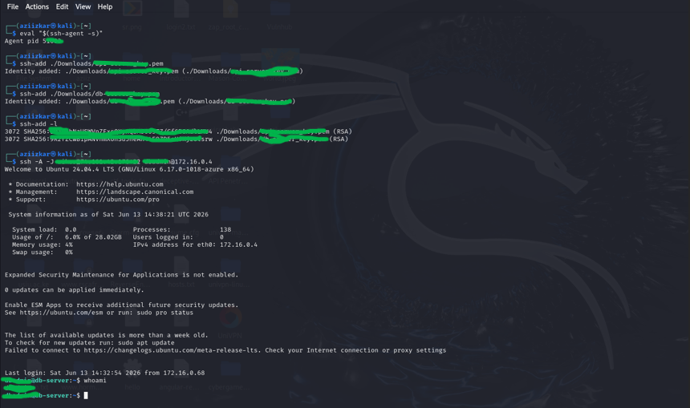

I also tried to ssh into the server from my local machine without multihop connection but with valid authentication key. The NSG dropped request and "connection timed out" was displayed on the terminal.

- Rule: 120 API server communication with PostgreSQL service on port 5432

For now, there is no PostgreSQL service running on port 5432 of the database server. To test that port is reachable from the api server, I initiated a simple python http server on port 5432.

I then used simple curl command and the server returned status code of 200 OK signalling success.

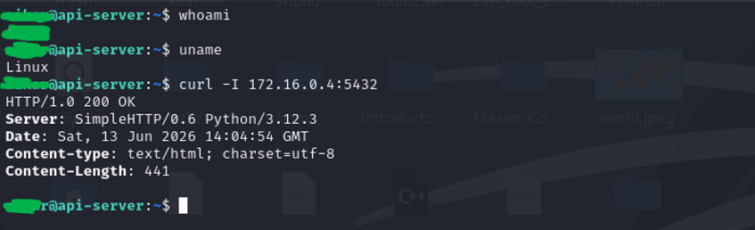

A similar curl command from my local machine hangs and returns nothing.
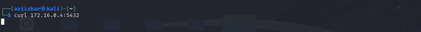

## System Hardening

In defense-in-depth, Network Security Groups (NSGs) cannot be the only walls to rely on. Endpoints should be made robust enough for attacks, should network-level firewalls fail and get bypassed.

### API Server Hardening

- System Updates & Automatic Security Patches
  I updated the package repositories and upgraded existing packages to ensure the server is up-to-date and have the latest package versions.
  I also installed unattended-upgrades to automatically apply future security patches, and ensured it is actively running.
  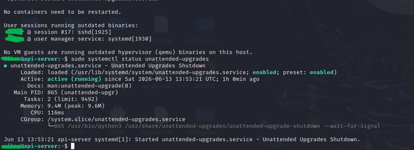

- Disabling compiler access for non-root users and lockdown of shadow file
  This ensures regular users or compromised web scripts to never have access to development tools like gcc or make which prevents attackers from compiling local exploits or building malicious binaries on the server if they get inside. Additionally, I locked the shadow file to ensure only root user have access hashed passwords to stop unauthorized accounts from reading or copying the password hashes for offline brute-force cracking attacks.
  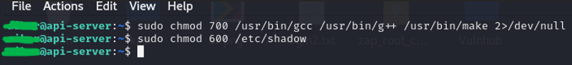

- Disabling SSH Root Login
  Although I configured the VM to use SSH public keys for authentication during deployment, allowing direct remote access to the root account is still a significant security risk. To mitigate this, I modified the SSH configuration file (/etc/ssh/sshd_config) to explicitly disable root login entirely by setting the directive to PermitRootLogin no. This ensures that anyone attempting to manage the server must first log in using a standard, unprivileged user account and manually escalate their privileges, adding an extra layer of defense against direct root brute-force attempts.
  

- Fail2Ban Installation and Configuration
  Since the API server is exposed to the public internet, malicious scripts will eventually find it and attempt to brute-force custom SSH port. Fail2Ban watches the log files and dynamically drops firewall blocks on abusive IPs.
  I installed fail2ban in the system and created a local configuration override. I opened the file to make threshold guidelines.
  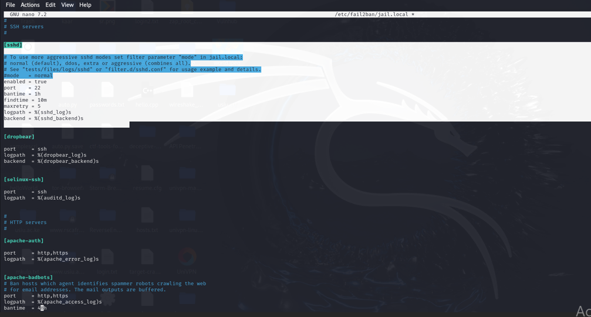
  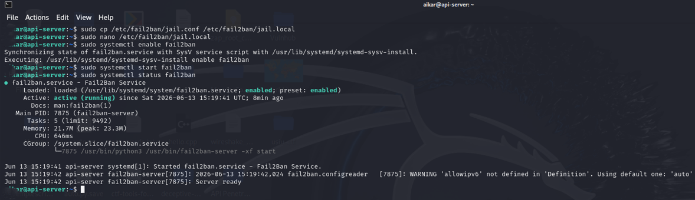

- Host-based Uncomplicated Firewall (UFW)
  In defense-in-depth, NSG only watch traffic originated from outside the network. Without host-based firewalls, the server may be vulnerable to insider threats. Operating system firewalls like UFW treat all interfaces distinctly, ensuring that even internal or adjacent network traffic must explicitly match host-level rules before interacting with system processes.
  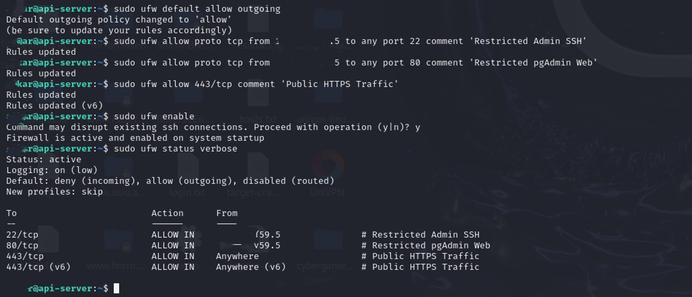

### Database Server Hardening

Because the database server houses our most critical data assets, it requires the exact same host-level security baseline as the API server to achieve true defense-in-depth. Even though this host is isolated inside a private subnet, I applied the same core OS hardening measures detailed in the API Server section above.

Shared OS Security Baseline: I enabled unattended-upgrades for automated security patches, restricted compiler access (gcc/make) for non-root users, locked down the /etc/shadow file, and disabled remote root logins over SSH.

However, because this server's role is strictly internal, I customized its host-level firewall rules to be even more restrictive:

<i>Host-based Firewall (UFW) Customization:</i> I configured the database server’s UFW to explicitly drop all packets unless they originate directly from the API server’s private IP address. This ensures that even if another resource is somehow introduced to the internal network, only our specific API gateway can touch ports 22 and 5432.

## Application and Service Deployment, Hardening

Now, with everything set, systems and networks well-hardened, it is time to deploy applications and services.

### PostgreSQL Service on the Database Server and PgAdmin deployment

The application running on the api server solely depends on the database for authentication, retrieval of records, and update.

#### Service Installation, Configuration, and App User, Database Creation

The database server is new and had no pre-configured services, therefore, i had to install postgresql from scratch.

At first, the installation didn't go through because the server is housed in a private subnet with no public ip address. This makes servers in the subnet incapable of updating packages and installing packages needed for different server services.
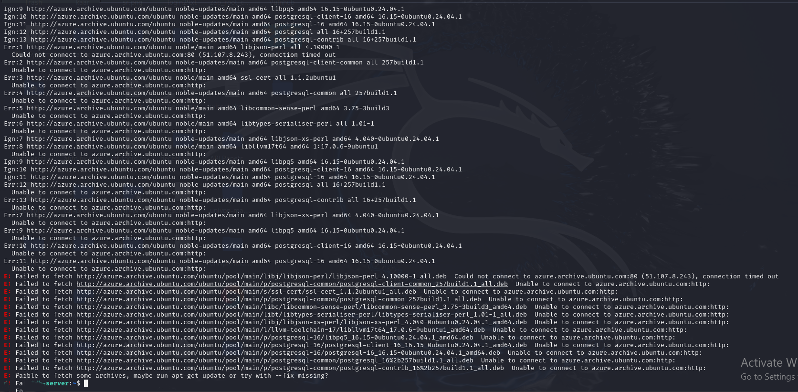

To overcome this without compromising security, i attached NAT gateway. This ensures server stay private, and as well provides outbound access for security patches and OS updates while blocking unsolicited connections from the internet

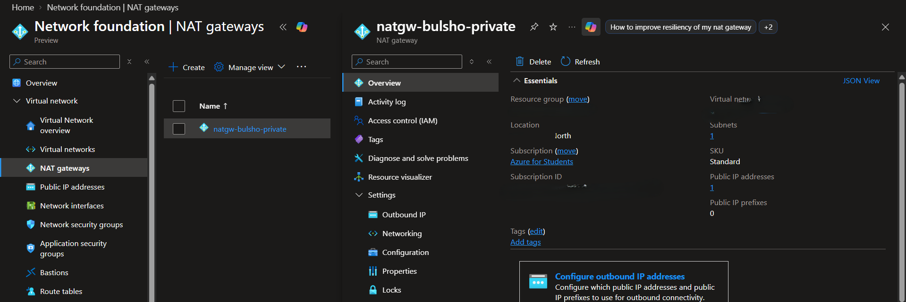

Upon attaching NAT Gateway to the private subnet, the installation succeeded.
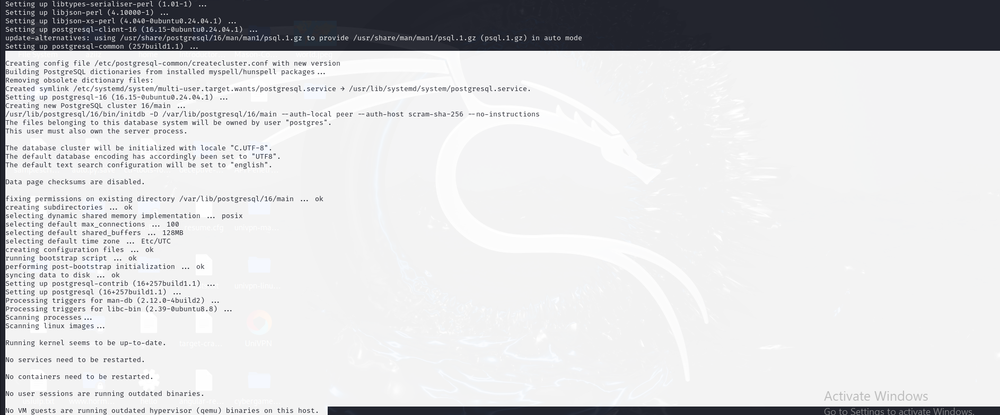

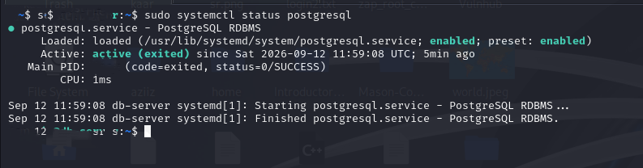

Owing to Bulsho's cost-sensitivity, the startup might use the server to host databases for different applications. This is best approached by creating a database and user for every application.

I Switched to the administrative postgres system account to access the PostgreSQL shell. In this shell, i created an isolated database, a dedicated least-privilege user, and grant scoped access.
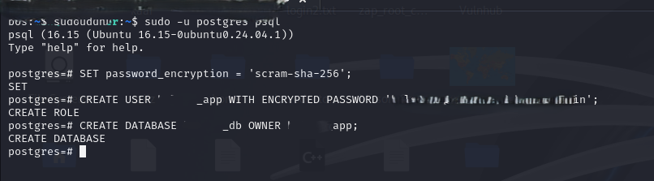

By default, PostgreSQL has privileges that allows public access of database schema. To revoke this and grant application user access, i ran the commands:

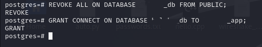

PostgreSQL, by default, listens to loopback address, and no other addresses. This blocks api server from communicating with the database. For seamless communincation, PostgreSQL is set to listen server's private ip address. To implement this, i modified the configuration file (postgresql.conf)

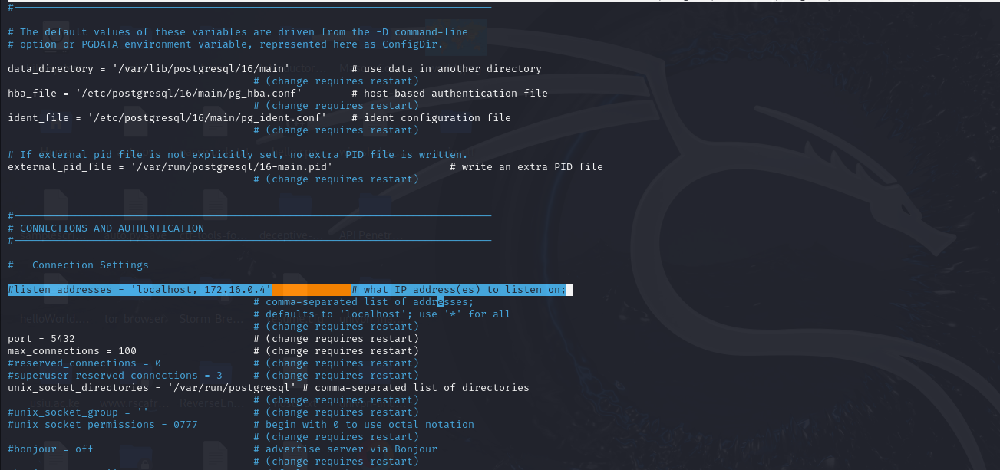

pg_hba.conf acts as PostgreSQL firewall. I modified this file to restrict access via Host-Based Authentication.

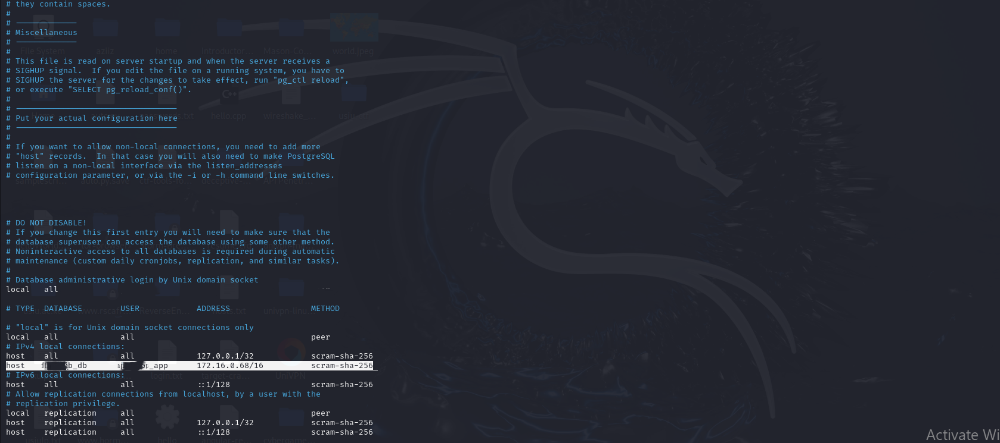

I then restarted postgresql service for the changes to take effect.

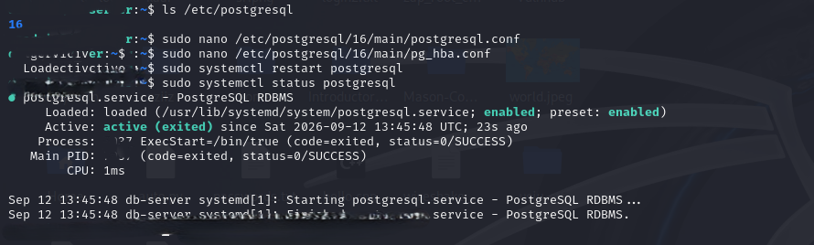

It is time to verify if the database server grants database access to the application server. I installed postgresql_client, a utility used to communicate with PostgreSQL service.
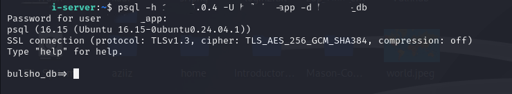

#### Database Schema Initialization

The database app ran by the startup has two tables which are essential for app to serve platform users. For security purpose, the table names and fields can not be mentioned.

I initialized the two tables and populated some dummy data for testing purpose.
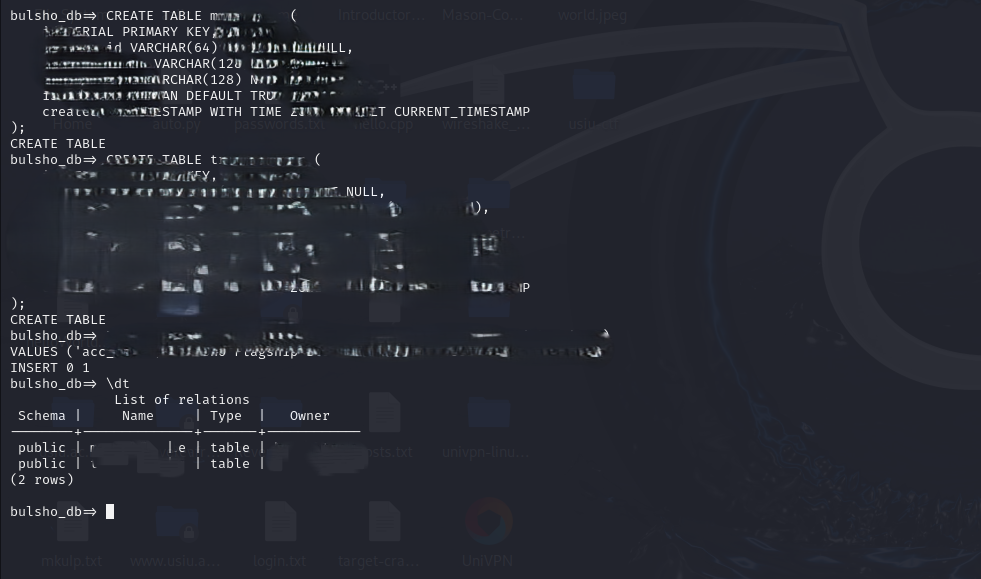

#### pgAdmin deployment on the API Server

I pulled pgAdmin4 image is pulled from Docker Hub and configured the login credentials and launched it. Additionally, i created volume for it to ensure persistence across pgAdmin containers.

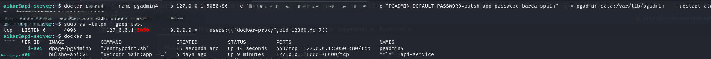

I then SSH-tunneled to access the pgAdmin web interface

The pgAdmin web interface is now accessible from the local machine loopback address
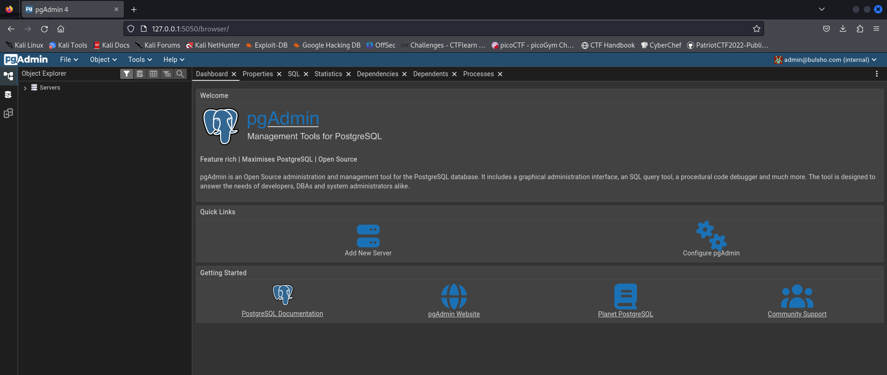

I configured connection to database server from the pgAdmin panel

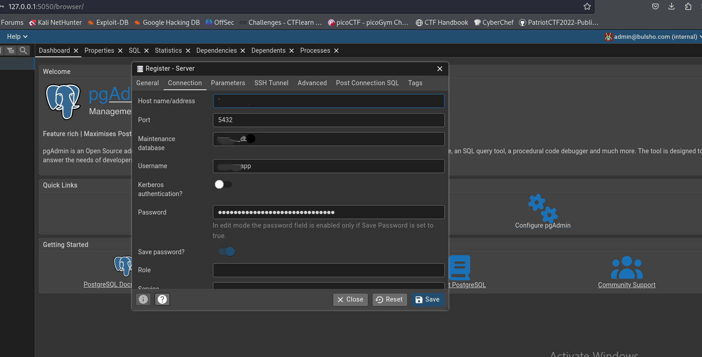

It shows databases with functionality to view tables, rows and edit them if need be.
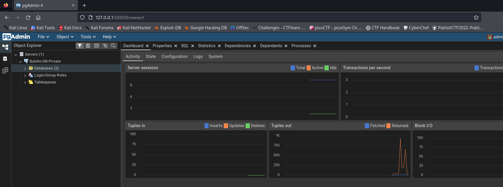

### Application deployment

In an audit finding, the application is not containerized and uses system-wide dependencies. This introduces poor app development as change in form of upgrade or downgrade of any dependency, due to another app requiring newer version could cause the app to break. The solution to this is containerization. Containerization packages application code, runtime, system tools and dependencies into single, isolated execution unit. Another importance of this approach is ease of spinning up different instances of the app from an image (blueprint) when there is traffic spike. Additionally, owing to absence of app containerization, there is no appAmor in place.

Another security loophole is: The business logic directly handles traffic with no edge guard. Uvicorn (Python) is not designed to receive requests and send responses, leaving applications susceptible to web attacks. The best industry practice recommends use of a proxy server such as Nginx. Nginx comes with advantages like rate limiting, compression, SSL/TLS Termination, load balancing, serving static assets and zero-downtime reloads.Nginx sits at the edge of the api server, between clients making requests and application runtime/business logic processing these requests to generate responses.

Finally, the app allows public access of documentation paths: /docs and /redoc. This gives information to attackers to have complete image of the API.

#### Application Containerization

The server is new and doesn't have docker preinstalled. I installed docker, enabled it and created new group to ensure current user runs docker commands without writing sudo every time.

After installing docker in the system,I created requirements.txt file that has all application dependencies. This file is referenced every time an instance is created.

Next, i created Dockerfile which contains set of instructions Docker executes sequentially to assemble the image. In the Dockerfile, a low privilege user is created to avoid containers getting root-level privilege

I then built the docker image, a template ths is used to create containers, whenever need arises.

Next, spinned up a container with the name bulsho-api-service and mapped port 8000 of the container to the 8000 of localhost for it to be reachable from localhost loopback address. The container also restarts from reboot or system shutdown.

To verify reachability of both authenticated and unauthenticated paths of app running in the container, i used Client URL (curl).

Unauthenticated path: /api/v1/health

Authenticated path: /api/v1/payments/charge
This path requires x-api-key header which comes hashed from PostgreSQL database upon user authentication.

### Nginx Installation and Configuration

I installed nginx on the server

In modern financial infrastructure, sending raw payment payloads or merchant API keys over unencrypted HTTP is an immediate deal-breaker, as anyone on the same wire could sniff that data in plaintext. It is good to create cryptographic keypair which gives Nginx the security certificates it needs to establish a TLS handshake, encrypting the transport channel end-to-end before any sensitive financial payload leaves the client.

With the certificate generated, i created a dedicated bulsho-site configuration file to keep application routing modular and isolated from distribution updates. This configuration binds to port 80 to force an automatic redirect to HTTPS, binds to port 443 to handle TLS termination, and transparently forwards valid requests down to the containerized FastAPI backend on loopback (127.0.0.1:8000).

Finally, i tested the API from my local machine to simulate a real merchant interacting with Bulsho's payment gateway over the public internet.

/health (unprotected path):

Accessing protected path /api/v1/payments with valid api key.

Accessing protected path /api/v1/payments with invalid api key.

## Conclusion
The infrastructure for Bulsho fintech has been hardened from flat, single-server to segmented, hardened infrastructure.
